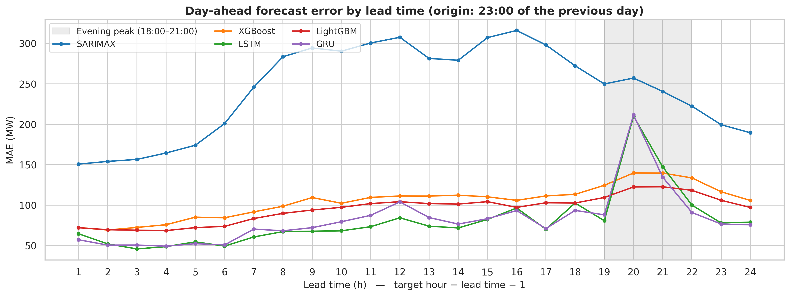
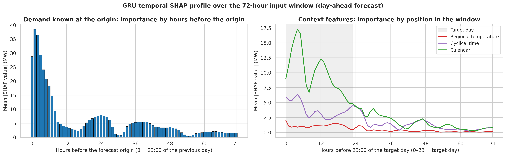

# Day-Ahead Load Forecasting for Ecuador's National Interconnected System

**A Research Proposal Comparing Lightweight Models with Statistical and Deep Learning Baselines**

[](https://www.python.org/)
[](https://www.tensorflow.org/)
[](https://lightgbm.readthedocs.io/)
[](https://xgboost.readthedocs.io/)
[](LICENSE)

**Author:** Jefferson Gramal · Yachay Tech University

---

## Project Overview

Ecuador's National Interconnected System (SNI) depends on hydropower. When reservoirs run low, as in the 2024 supply deficit, the national operator **CENACE** must schedule load shedding and commit thermal units one day in advance. Every decision starts from one input: the hourly demand forecast for the next day.

This project benchmarks **five day-ahead forecasters** under one chronological protocol. **Every day at 23:00**, each model forecasts the **24 hourly demands of the next day** (lead times 1 to 24 h) using only the demand observed up to that moment.

| Role | Model | Day-ahead strategy |
|---|---|---|
| Baseline 0 (statistical) | SARIMAX | 24-step Kalman projection from the 23:00 origin |
| Baseline 1 (tree ensemble) | XGBoost | 24 models, one per hour of the next day |
| Baseline 2 (deep learning) | LSTM | One network with 24 outputs |
| **Proposed 1** | **LightGBM** | 24 models, one per hour of the next day |
| **Proposed 2** | **GRU** | One network with 24 outputs |

The GRU is explained with **Expected Gradients** (the Shapley-value method behind SHAP's `GradientExplainer`), implemented directly with `tf.GradientTape` for 3-D recurrent inputs (72 time steps × 11 features, 24 outputs).

> [!IMPORTANT]
> **Data scope.** Public hourly SNI telemetry for 2020 to 2025 was not available. The hourly target is a **semi-synthetic series**: official CENACE monthly energy disaggregated with representative daily load profiles, calendar factors and AR(1) variability. The monthly energy matches CENACE exactly, but the intra-day shape is modelled. Results validate the methodology. Validation on real hourly CENACE records is the next research step.

---

## Main Contributions & Results

**Contributions**

- A reproducible pipeline that turns CENACE monthly energy into a continuous hourly series and accepts real telemetry without code changes.
- Multi-regional apparent temperature for the three main load centres: **Guayaquil** (coast), **Quito** and **Cuenca** (highlands).
- A day-ahead benchmark with error by lead time, peak-band bias, daily-peak timing and tail error.
- Gradient-based explainability for a multi-output GRU, mapped to 82 named inputs and to the 72-hour input window.

**Test set:** 8,895 hours (26 Dec 2024 to 31 Dec 2025, 371 days), single seed (42).

| Model | Role | MAE (MW) | RMSE (MW) | MAPE (%) | R² | Train time (s) |
|---|---|---:|---:|---:|---:|---:|
| SARIMAX | Baseline 0 | 243.21 | 321.46 | 6.68 | 0.666 | 11.5 |
| XGBoost | Baseline 1 | 104.45 | 135.87 | 2.74 | 0.940 | 227.6 |
| LSTM | Baseline 2 | **80.40** | **106.12** | **2.11** | **0.964** | 68.9 |
| LightGBM | Proposed 1 | 95.11 | 122.01 | 2.51 | 0.952 | **10.6** |
| GRU | Proposed 2 | 82.19 | 107.78 | 2.15 | 0.963 | 96.8 |

**Evening peak band (18:00 to 21:00)**, the hours that drive load-shedding planning:

| Model | Peak MAE (MW) | Peak bias (MW) | Daily-peak MAE (MW) | Peak-hour match | P95 \|error\| (MW) |
|---|---:|---:|---:|---:|---:|
| SARIMAX | 242.5 | −43.7 | 256.0 | 94.1 % | 653.3 |
| XGBoost | 134.4 | −102.1 | 139.1 | 89.0 % | 267.3 |
| LSTM | 134.5 | −105.4 | 196.5 | 69.3 % | 218.8 |
| **LightGBM** | **118.2** | −87.0 | **122.6** | 92.7 % | 246.1 |
| GRU | 131.2 | −99.8 | 189.7 | 28.6 % | **218.6** |

**Key findings**

- **LightGBM vs. XGBoost:** 9 % lower MAE, **21× faster training**, and the best model in the evening peak.
- **GRU vs. LSTM:** statistically indistinguishable (2 % MAE gap, one seed) with 24 % fewer parameters.
- **All learning models vs. SARIMAX:** 57 % to 67 % lower MAE in the day-ahead setting.
- **Peak under-forecast:** every model under-forecasts 18:00 to 21:00. LSTM and GRU miss 19:00 by about 207 MW and often shift the daily peak to 20:00. Per-hour tree models keep the sharp peak shape.
- **GRU drivers:** past demand 52.1 %, calendar 31.5 % (`day_type` ranks first), cyclical time 14.4 %, temperature 1.9 %.

<p align="center">
  
</p>

<p align="center">
  
</p>

---

## Repository Structure

```text
├── 01_data_ingestion_and_preprocessing.ipynb    # Hourly series and dataset
├── 02_model_training_and_evaluation.ipynb       # Training and metrics of the 5 models
├── 03_evaluation_and_explainability_shap.ipynb  # Figures, peak analysis, Expected Gradients
├── datos_demanda/     # CENACE monthly energy and reconstructed hourly series
├── data/              # Weather cache, dataset, test forecasts, metrics
├── models/            # Trained models and scalers
├── reports/figures/   # Figures
└── requirements.txt
```

---

## Quickstart & Installation

**1. Clone the repository**

```bash
git clone https://github.com/JeffersonG21/Day-Ahead-Load-Forecasting-for-Ecuador-s-.git
cd Day-Ahead-Load-Forecasting-for-Ecuador-s-
```

**2. Create and activate a virtual environment** (Python 3.10 to 3.12 recommended)

```bash
python -m venv .venv

# Linux / macOS
source .venv/bin/activate

# Windows (PowerShell)
.venv\Scripts\Activate.ps1
```

**3. Install dependencies**

```bash
pip install --upgrade pip
pip install -r requirements.txt
```

> [!TIP]
> A GPU speeds up LSTM, GRU and Expected Gradients but is not required. The notebooks also run on **Google Colab**: upload the project folder to `MyDrive/Project_IA/` and the notebooks mount Drive automatically. Outside Colab, they use the current folder as project root.

---

## How to Reproduce the Experiments

Run the notebooks **in order**. Each one reads the outputs of the previous one.

```bash
jupyter lab
```

### Step 1 · `01_data_ingestion_and_preprocessing.ipynb`

- Disaggregates CENACE monthly energy into an hourly series (Dec 2020 to Dec 2025, 44,568 h) and checks that every month matches the official total.
- Downloads hourly **apparent temperature** for Guayaquil, Quito and Cuenca from the Open-Meteo archive (cached in `data/`).
- Builds lags `lag_1h` to `lag_95h`, sine/cosine encodings of hour and day of week, and an Ecuadorian holiday calendar that honours the holiday-transfer law.
- **Output:** `data/dataset_stlf_ecuador.csv`

### Step 2 · `02_model_training_and_evaluation.ipynb`

- Chronological split: first 80 % for training (last 10 % of it for early-stopping validation), last 20 % for testing. Min-Max scaling fitted on training data only.
- For lead time *h*, each model uses the **82 inputs** known at the 23:00 origin: 72 demand lags (`lag_h` to `lag_(h+71)`), 3 temperatures, 4 cyclical encodings, 3 calendar flags.
- Trains SARIMAX, XGBoost, LSTM, LightGBM and GRU, and computes MAE, RMSE, MAPE, R² and training time.
- **Outputs:** `data/predicciones_test.csv`, `data/comparacion_modelos.csv`, `models/`

### Step 3 · `03_evaluation_and_explainability_shap.ipynb`

- Plots the benchmark, a 744-hour test window and the **MAE by lead time**.
- Computes peak (18:00 to 21:00) and valley (02:00 to 05:00) indicators: MAE, bias, daily-peak error, peak-hour match and P95 error.
- Explains the GRU with **Expected Gradients** (1,000 test hours, 500 background windows, 200 samples per hour) and maps the attributions to 82 inputs and to the 72-hour window.
- **Output:** `reports/figures/*.png`

Measured training times on a Colab GPU runtime are listed in the results table. XGBoost (24 models with depth 50) is the slowest step at about 4 minutes.

Every run uses seed `42` and enables TensorFlow op determinism. Small numerical differences may still appear across hardware.

---

## Data Availability & Sources

| Source | Content | Access |
|---|---|---|
| **CENACE**, *Informe Anual* 2021 (Table 1.6), 2023, 2024 and 2025 (Table 1.8) | Monthly SNI energy demand, Jan 2020 to Dec 2025 (GWh) | [cenace.gob.ec](https://www.cenace.gob.ec) · transcribed in `datos_demanda/` |
| **Open-Meteo** Historical Weather API | Hourly apparent temperature for Guayaquil, Quito, Cuenca | [open-meteo.com](https://open-meteo.com/) · free, no key required |
| **python-holidays** | Ecuadorian national holidays | [pypi.org/project/holidays](https://pypi.org/project/holidays/) |

**Related work:** the XGBoost and LSTM configurations follow Brito, W., Sánchez, W. (2026). *Comparación de modelos LSTM y XGBoost para la predicción de demanda eléctrica en el sistema ecuatoriano.* Revista Técnica "energía", 22(2), 24 to 31.

To use **real hourly telemetry**, place a CSV with columns `fecha_hora` and `demanda_mw` in `datos_demanda/` and remove the reconstruction step. The rest of the pipeline runs unchanged.

---

## Citation & License

If you use this code or results, please cite:

```bibtex
@misc{gramal2026dayahead,
  author       = {Gramal, Jefferson},
  title        = {Day-Ahead Load Forecasting for Ecuador's National Interconnected System:
                  A Research Proposal Comparing Lightweight Models with Statistical
                  and Deep Learning Baselines},
  year         = {2026},
  institution  = {Yachay Tech University},
  howpublished = {\url{https://github.com/JeffersonG21/Day-Ahead-Load-Forecasting-for-Ecuador-s-.git}},
  note         = {Research proposal}
}
```

This project is released under the **[MIT License](LICENSE)**. Data from CENACE and Open-Meteo remain subject to the terms of their providers.
